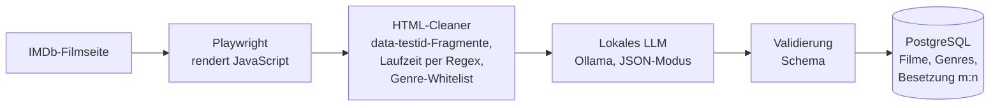

# LLM-basierte Datenextraktion aus dem Web

Code zur Bachelorarbeit **„LLM-basierte Datenextraktion aus dem Web – Implementierung und
Evaluation am Beispiel der IMDb Top 250"**. B.Sc. Wirtschaftsinformatik, Universität Bremen,
AG Datenbanken. Betreut von Prof. Dr. Sebastian Maneth und Dr. Sabine Kuske. **Note 1,0.**

**Die Frage:** Klassische Scraper hängen an festen XPath- oder CSS-Pfaden und brechen bei
jeder Layoutänderung. Ist ein lokal laufendes Sprachmodell, das die Seite semantisch liest,
robuster? Und was braucht es, damit die Extraktion auch genau ist?

## Ergebnisse auf einen Blick

- **F1 = 0,97** (95-%-KI [0,96; 0,98]) auf allen 250 Filmen der IMDb Top 250, mit
  `qwen2.5:3b` lokal über Ollama.
- **Robuster als XPath:** Werden alle CSS-Klassen und `data-testid`-Attribute umbenannt,
  fällt ein XPath-Wrapper auf F1 = 0,00. Die LLM-Pipeline arbeitet mit **F1 = 0,86** weiter
  (gepaartes 95-%-KI für ΔF1: [+0,82; +0,90], n = 50).
- **Die Eingabe zählt mehr als das Modell:** Der erste Lauf lag bei F1 = 0,72. Den Sprung auf
  0,97 brachten zwei deterministische Eingriffe in der Vorverarbeitung, kein besserer Prompt
  und kein größeres Modell.
- **Klein schlägt groß:** `gemma3:4b` erreicht F1 = 0,98 bei 7,8 s pro Film und ist signifikant
  besser als `qwen2.5:3b` (McNemar, p = 0,0002, Bonferroni-korrigiert). Gegenüber `gpt-4o`
  und `gpt-4o-mini` (je F1 = 0,933) gibt es keinen messbaren Unterschied.
- **Auch Relationen:** Die Besetzung als m:n-Relation Film ↔ Schauspieler mit Rolle erreicht
  eine Schauspieler-F1 von 0,95 bei einer Rollengenauigkeit von 0,97.

## Architektur



Der Ansatz ist **hybrid**. Eine deterministische, strukturbewusste Vorverarbeitung reduziert
rund 1,3 MB HTML auf wenige hundert Zeichen Schlüssel-Wert-Fragmente. Das Sprachmodell
bildet sie auf das Zielschema ab. Anders als bei der Wrapper-Induktion wird kein
Selektor-Satz gelernt, und anders als bei der reinen LLM-Extraktion muss das Modell nicht
das gesamte DOM verstehen.

## Ergebnisse im Detail

**Entwicklung der Genauigkeit**

| Lauf | Gesamt-F1 |
|---|---:|
| Erster Durchlauf (Laufzeit und Genres versagen) | 0,72 |
| + deterministische Laufzeit-Vorberechnung, Genre-Whitelist, JSON-Modus | **0,97** |
| Ablation: generische Tag-Bereinigung statt IMDb-bewusstem Cleaner (n = 50) | 0,86 |

**Modellvergleich** (identischer Prompt, Cleaner und Validierung)

| Modell | Parameter | F1 | Sekunden pro Film |
|---|---:|---:|---:|
| `gemma3:4b` | 4 Mrd. | **0,98** | **7,8** |
| `qwen2.5:3b` | 3 Mrd. | 0,97 | 13,2 |
| `qwen3:8b` | 8 Mrd. | kein signifikanter Unterschied zu `qwen2.5:3b` (p = 0,65) | rund 5× langsamer |
| `gpt-4o`, `gpt-4o-mini` (n = 50) | – | 0,933 | – |

**Übertragbarkeit auf andere Domains**

| Domain | F1 |
|---|---:|
| quotes.toscrape.com | 0,99 |
| books.toscrape.com | 0,96 |
| letterboxd.com | 0,92 |

**Die Grenze des Ansatzes:** Auf Letterboxd liegt die Sternebewertung dem Modell als fertig
berechneter Wert im Prompt vor. Das Modell gibt ihn trotzdem nur mit F1 = 0,70 korrekt
wieder, ein direkter deterministischer Zugriff liefert 1,00. Die Schwachstelle ist also nicht
das Verständnis der Seite, sondern die nicht garantiert deterministische Ausgabe.

**Absicherung der Messung**

- Ground Truth manuell an 50 Filmen geprüft: 289 von 297 Feldern stimmen
  (97,3 %, Wilson-KI [0,95; 0,99]).
- Fehlerklassen (Datenambiguität, Parsing, Halluzination) von zwei Annotatoren
  unabhängig eingeordnet: Cohen's κ = 0,67.
- Bootstrap-Konfidenzintervalle, gepaarte Vergleiche und McNemar-Tests mit
  Bonferroni-Korrektur.

## Repository

```text
main.py                  Einstiegspunkt: Top-250 scrapen, extrahieren, speichern
config.py                Konfiguration (liest .env)
scraper/                 Playwright-Spider und HTML-Cleaner
llm/                     Ollama- und OpenAI-Client, Prompts, generischer Extraktor
pipeline/                Verarbeitung pro Film
database/                SQLAlchemy-Modelle inklusive m:n-Besetzung
sites/                   Konfigurationen für toscrape und Letterboxd
evaluation/              Evaluations-, Ablations- und Signifikanzskripte, aggregierte Ergebnisse
robustness/              Mutationsexperiment: Snapshot → Mutation M0–M4 → Evaluation
docs/DOKUMENTATION.md    technische Dokumentation der Module
```

## Ausführen

Voraussetzungen: Python 3.10+, [Ollama](https://ollama.com), optional PostgreSQL.

```bash
./setup.sh                 # venv, Abhängigkeiten, Playwright-Browser
cp .env.example .env
ollama pull qwen2.5:3b
python main.py -n 10 --no-db    # 10 Filme, nur JSON-Export
python main.py                  # alle 250 Filme mit Datenbank
```

| Option | Bedeutung |
|---|---|
| `-n, --num-movies N` | Anzahl Filme (Standard 250) |
| `--no-db` | ohne PostgreSQL, nur JSON-Export |
| `-v, --verbose` | ausführliches Logging |
| `--config` | Konfiguration anzeigen |
| `-y, --yes` | ohne Bestätigung starten |

Das Robustheitsexperiment läuft in drei Schritten:
`robustness/01_snapshot.py --n 50`, `02_mutate.py`, `03_evaluate_n50.py`.

## Hinweise zu den Daten

Gescrapte Seiten, Extraktionsergebnisse pro Film und die Ground-Truth-Dateien sind **nicht**
im Repository enthalten, weil die Nutzungsbedingungen von IMDb und Letterboxd ihre
Weiterverbreitung nicht erlauben. Die Skripte erzeugen sie neu
(`evaluation/generate_ground_truth_250.py`, `robustness/01_snapshot.py`). Unter
`evaluation/` und `robustness/` liegen nur aggregierte Ergebnisse (F1, Intervalle, κ).
Der Code diente ausschließlich der wissenschaftlichen Untersuchung.

Der Volltext der Arbeit ist auf Anfrage erhältlich.
